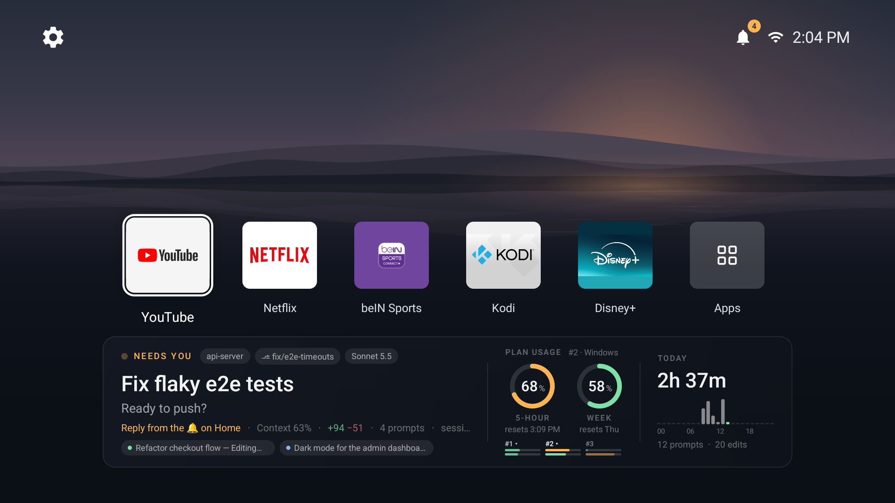
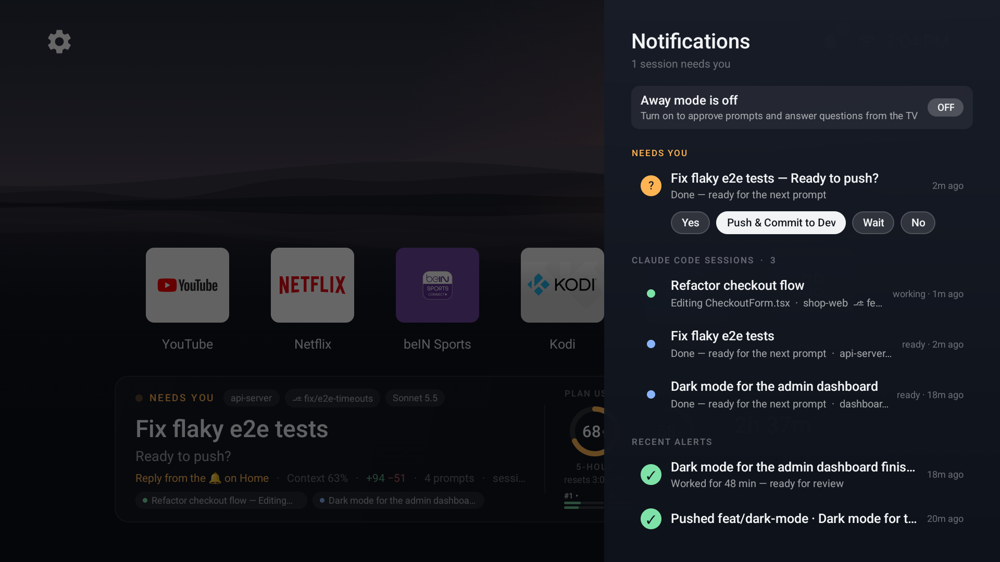
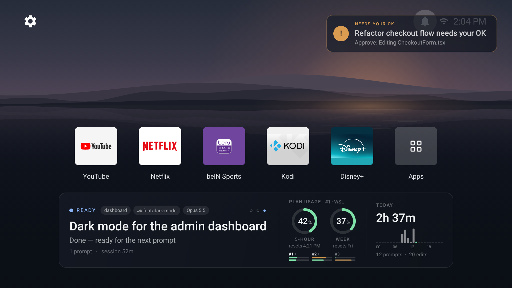

# Claude Code TV

A live **Claude Code status board for Android TV / Google TV**. It's a small custom launcher whose home screen shows what every Claude Code session is doing, how much of your plan you've used, and pops up an alert over whatever's playing when a session needs you. From the couch you can answer with preset replies like *Yes / Push & Commit to Dev / Wait / No*.



| Bell panel: answer from the remote | Alert over any app |
|---|---|
|  |  |

*(Screenshots use the built-in demo data.)*

## What it shows

- **Sessions.** Each Claude Code session is shown by its name (the title Claude Code gives it), with folder, branch and model. You see its state (needs you / working / ready / away) and its current activity ("Editing CheckoutForm.tsx", "Running npm test"), with a live turn timer. With several sessions the card rotates every 10 s. Sessions that need you are pinned.
- **Plan usage.** 5-hour and weekly rings for the account the session on screen runs on, with reset times and weekly pace. If you use cswap (claude-swap) with several accounts, a strip shows all of them.
- **Today.** Active time (wall-clock, parallel sessions aren't double counted), hourly activity bars, prompts and edits.
- **Alerts** pop up over any app when a session:
  - needs a permission ("Approve: Running git push")
  - asks a question
  - ends its turn offering to deploy, push or open a PR
  - finishes a long turn (3+ min)
  - has just pushed, deployed or opened a PR
- **Bell panel.** Pending questions with reply buttons, every session, recent alerts, and Android's own notifications (handy when the stock Google TV launcher is disabled).
- **Answering from the TV.**
  - A turn that ends with a question gets preset replies. Your pick wakes the session (Stop hook with `asyncRewake`), and typing at the PC first simply cancels it.
  - Optional **Away mode** lets you answer permission prompts and Claude's multiple-choice questions from the remote. Off means the hooks step aside instantly.
- A complete launcher: painted wallpaper, pinned app row, apps grid, long-press menus (move, remove, app info, uninstall).

## How it works

```
Claude Code ──hooks──► hooks/tv_status_hook.py ──POST /api/event──► Vercel function ──► Upstash Redis
   (CLI, desktop app, statusLine)    (local, privacy filter)                                  │
TV launcher ◄──────────── GET /api/status every 15–20 s ◄─────────────────────────────────────┘
TV bell panel ──POST /api/control (reply id)──► API ◄──poll── hooks/tv_reply_wait.py ──► wakes the session
```

- `status-api/`: a few Vercel functions (plain Node, no dependencies) with a state machine for sessions, usage and alerts. Unit tests: `npm test`.
- `hooks/`: Python 3, standard library only. Hooks run `async` and never block Claude Code.
- `launcher/`: plain Java, no AndroidX, no Gradle. It builds with the Android SDK tools in a few seconds to a ~60 KB APK. It needs Android 11+.

### Privacy

The hook reduces every event to a short line on your machine before anything is sent. **Prompt text, file contents and command arguments never leave your PC.** Shell commands become just the program (`Running npm test`), and "ready to deploy" detection runs locally, so only the category is sent. Account emails are only used locally to match logins; the API sees "#1", "#2". The TV only sends option **ids** back. The text behind each reply lives in `hooks/tv_replies.json` on your PC, and the API rejects any option the waiting hook didn't offer.

## Setup

You need: Node 20+ and the Vercel CLI, Python 3, the Android SDK (build-tools + platform 34, JDK 17), ADB access to the TV (wireless debugging), a free Vercel account and Upstash Redis.

### 1. API (Vercel)

```bash
cd status-api
vercel link                                   # creates the project
vercel integration add upstash/upstash-kv     # free Redis; injects KV_REST_API_URL / KV_REST_API_TOKEN
openssl rand -hex 24 | vercel env add INGEST_TOKEN production
openssl rand -hex 24 | vercel env add READ_TOKEN production
printf 'Europe/Dublin' | vercel env add STATUS_TZ production   # your timezone, for "today"
vercel deploy --prod
```

Put the same values in `.env.local` (copy `env.example`).

### 2. Claude Code hooks

```bash
cp env.example .env.local                          # fill in STATUS_URL, INGEST_TOKEN, READ_TOKEN
cp tv_status.env.example hooks/tv_status.env       # fill in TV_STATUS_URL and TV_STATUS_TOKEN (= INGEST_TOKEN)
python3 hooks/install_hooks.py                     # status hooks + statusLine in ~/.claude/settings.json
```

- **WSL + the Windows desktop app:** add `--windows /mnt/c/Users/<you>/.claude/settings.json`. Sessions the app runs on `\\wsl.localhost\...` folders read the Windows settings. The installer calls the same hook through `wsl.exe`, with `MSYS_NO_PATHCONV=1`, because Windows Claude Code runs hooks via Git Bash.
- **Plan usage with cswap:** `python3 hooks/install_hooks.py --usage-timer` writes a systemd user timer (2 min) and prints the command to enable it.
- **Answering from the TV:** `python3 hooks/install_reply_hooks.py` (or `--no-approvals` for turn replies only). Edit the presets in `hooks/tv_replies.json`.

Running sessions pick up the hooks automatically. Everything can be removed with `--remove`.

### 3. TV launcher

```bash
cd launcher
./build.sh                                  # → build/attic-home.apk (creates a signing key on first run)
./install.sh <tv-ip>:<port> --replace       # installs, grants overlay + notification access, sets it as home
```

The package is `tv.attic.home` ("Attic Home"). Keep `launcher/attic-launcher.jks` and its password: updates must be signed with the same key.

### Try it without Claude Code

```bash
cd status-api && INGEST_TOKEN=x READ_TOKEN=demo STATUS_TZ=UTC node dev-server.js 8790 --demo
```

Open `http://localhost:8790/?key=demo` for a browser preview, or point a TV at it:

```bash
adb reverse tcp:8790 tcp:8790
STATUS_URL=http://localhost:8790/api/status READ_TOKEN=demo launcher/dev-install.sh <tv-ip>:<port>
```

The dev copy installs next to your launcher as `tv.attic.home.dev`.

You can also send your own alerts: `python3 hooks/tv_notify.py "Build finished" "APK is ready" --kind done`.

## Limits

- Hooks only see sessions on machines where they're installed. They don't fire for claude.ai/code cloud sessions.
- The Claude desktop app doesn't run `statusLine`, so context %, model display name and lines added are CLI-only. Plan usage comes from cswap either way.
- Plan usage % needs cswap, or the statusLine `rate_limits` (Pro/Max/Team logins).
- "Ready to ship" detection is a phrase match on Claude's closing message. It's good, not perfect.

## How it was built

This was built in a single long session with **Claude Code**, with me steering. Claude Code:
- connected to the TV over ADB, worked out that the old launcher had no internet permission and no source, and rebuilt it from scratch;
- wrote the API with tests, the hooks and the launcher;
- checked every UI change with ADB screenshots of the real TV;
- verified the undocumented `asyncRewake` wake-up on a throwaway session;
- debugged the Windows-side sessions from their transcripts.

Its own safety check refused to install the hooks that can approve permissions from a remote device, so you run that installer yourself, deliberately.

Not affiliated with Anthropic. MIT licensed.
